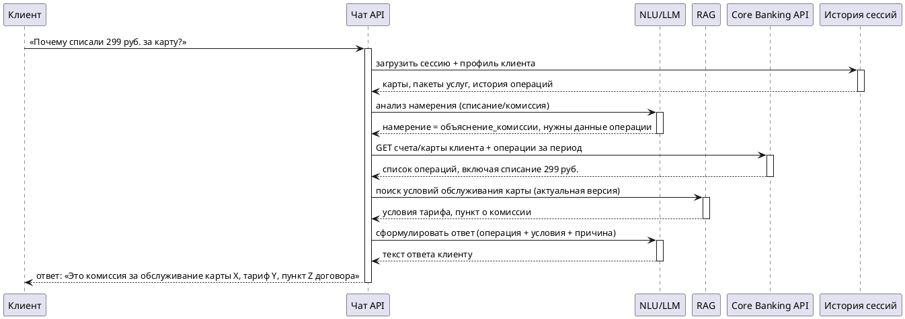
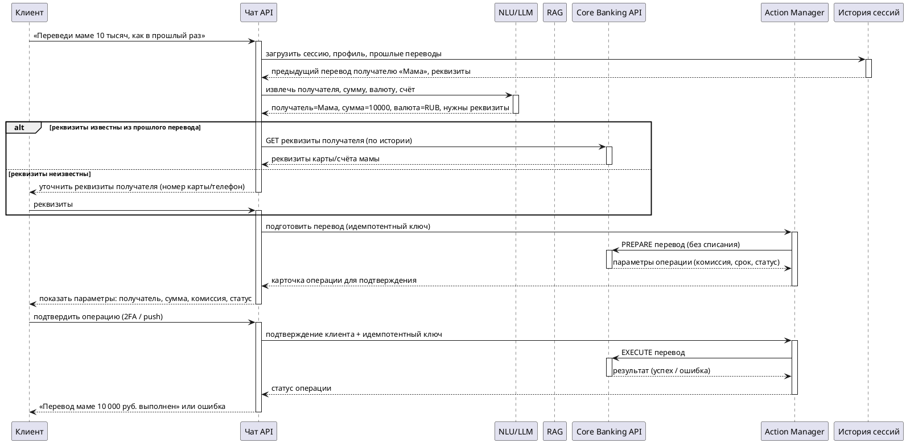
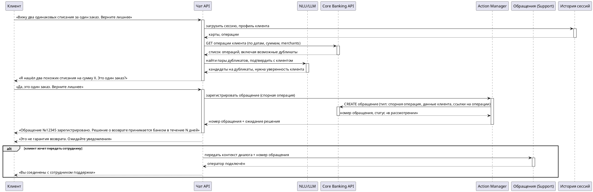

# 2.3 Интеграции

| Интеграция | Протокол | Аутентификация | Направление | Назначение |
|------------|----------|----------------|-------------|------------|
| Клиент ↔ Chat API | HTTPS / WSS | JWT (OAuth2 PKCE) | ↔ | Чат, получение ответов |
| Chat API ↔ Core Banking API | REST (gRPC) | mTLS + client cert | → | Баланс, карты, операции, реквизиты |
| Chat API → RAG Service | HTTP | Внутренний токен | → | Поиск ответов из базы знаний |
| Action Manager → Core Banking | REST | mTLS + ключ идемпотентности | → | Подготовка переводов, обращений |
| Escalation → Support System | REST | OAuth2 | → | Передача диалога сотруднику |
| Audit → SIEM | Syslog / Kafka | Сертификат | → | Аудит всех действий |

## 2.4 Sequence: сценарий А (Объяснение комиссии)

## 2.5 Sequence: сценарий Б (Перевод по разговорному запросу)

## 2.6 Sequence: сценарий В (Спорная операция)

## 2.7 Границы доверия и модели угроз

| Граница | Угроза | М控制 |
|---------|--------|------|
| Клиент → Chat API | Подделка запроса, перехват токена | JWT с коротким временем жизни, PKCE, HTTPS |
| Chat API → LLM | Утечка персональных данных в запрос к модели | Деидентификация (маскировка PAN, ФИО), только необходимые данные |
| LLM → Chat API | Недостоверный ответ, галлюцинации | RAG с подтверждением из источника, человеческий ревью для критичных ответов |
| Action Manager → Core | Двойное списание, несанкционированный перевод | Идемпотентность, подтверждение клиента, mTLS |
| Любой компонент → Core | Несанкционированный доступ к счетам клиента | OAuth2 scopes, проверка прав на уровне Core API |